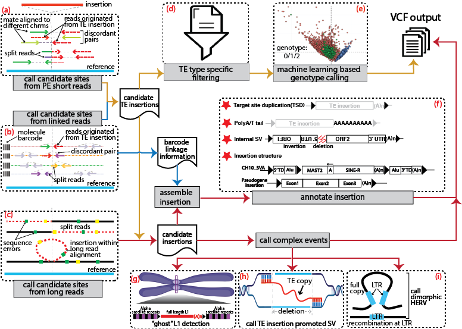

## xTea

xTea (comprehensive transposable element analyzer) is designed to identify TE insertions from paired-end Illumina reads, barcode linked-reads, long reads (PacBio or Nanopore), or hybrid data from different sequencing platforms and takes whole-exome sequencing (WES) or whole-genome sequencing (WGS) data as input. 




## Download

1. short reads (Illumina and Linked-Reads)

	+ 1.1 latest version

	```
	git clone https://github.com/parklab/xTea.git
	```

	+ 1.2 cloud binary version

	```
	git clone --single-branch --branch release_xTea_cloud_1.0.0-beta  https://github.com/parklab/xTea.git
	```

2. long reads (PacBio or Nanopore)

	```
	git clone --single-branch --branch xTea_long_release_v0.1.0 https://github.com/parklab/xTea.git
	```

3. de novo TE insertion (trio data as input; check xTea-trioML branch for more details)

	```
	git clone --single-branch --branch xTea-trioML https://github.com/parklab/xTea.git
	```

4. mosaic TE insertion (high depth WGS data as input; check xtea_mosaic branch for more details)

	```
	git clone --single-branch --branch xtea_mosaic https://github.com/parklab/xTea.git
	```

5. pre-processed repeat library used by xTea (this library is used for both short and long reads)  
	
	```
	wget https://github.com/parklab/xTea/raw/master/rep_lib_annotation.tar.gz
	```
	
6. gene annotation files are downloaded from GENCODE. Decompressed gff3 files are required.
	+ For GRCh38 (or hg38), gff3 files are downloaded and decompressed from https://www.gencodegenes.org/human/release_33.html ;
	+ For GRCh37 (or hg19), gff3 files are downloaded and decompressed from https://www.gencodegenes.org/human/release_33lift37.html ;
	+ For CHM13v2, gff3 files are downloaded from https://s3-us-west-2.amazonaws.com/human-pangenomics/T2T/CHM13/assemblies/annotation/chm13.draft_v2.0.gene_annotation.gff3;
	+ Or use the latest version

## Dependencies

1. bwa (version **0.7.17** or later, which requires the **-o** option), which can be downloaded from https://github.com/lh3/bwa.
2. samtools (version 1.0 or later), which can be downloaded from https://github.com/samtools.
3. minimap2 (for long reads only), which can be downloaded from https://github.com/lh3/minimap2.
4. wtdbg2 (for long reads only), which can be downloaded from https://github.com/ruanjue/wtdbg2.
5. Python 2.7+/3.6+
	+ For the following packages, only a conda-based installation in shown. You may also install these in other ways, such as pip. 
	+ pysam (https://github.com/pysam-developers/pysam, version 0.12 or later) is required.
		+ Install pysam:
			```
			conda config --add channels r
			conda config --add channels bioconda
			conda install pysam -y
			```
	+ sortedcontainers
		+ Install sortedcontainers
		`conda install sortedcontainers -y`

	+ numpy, scikit-learn, and pandas
		+ Install numpy, scikit-learn and pandas
		`conda install numpy scikit-learn=0.18.1 pandas -y`

	+ DF21 (this is used to replease scikit-learn, which is complained by several users for version incompatible)
		+ Install DF21
		`pip install deep-forest`

6. Note: bwa and samtools need to be added to the $PATH.


## xTea2 (New Single-Process Workflow)

xTea2 is a reimplementation of xTea that consolidates the multi-step pipeline into a single self-contained Python entry point (`xtea/run_xtea.py`). Unlike the upstream workflow (which generates a shell script via `gnrt_pipeline_local_v38.py` that must then be submitted), xTea2 runs start-to-finish in one invocation. The implementation includes a new **C++ scan engine** (`src/csrc/xtea_scan`) that collects clipped and discordant reads in a single BAM pass, replacing multiple expensive per-type scans.

### Additional Dependencies for xTea2

Beyond the dependencies listed above, xTea2 requires:

- **htslib (>= 1.22)**, discoverable via `pkg-config`. Used by the C++ scan engine for BAM/CRAM reading.
- **Python `pysam`** (bundled as a dependency of the conda xTea package; available via `conda install pysam` if installing separately).
- The **pkg-config** utility to locate htslib at build time.
- **Python >= 3.10 and `onnxruntime` >= 1.19**, required by the genotype step. Because genotyping is
  on the critical path to the final VCF, an environment without onnxruntime cannot complete a
  germline run.

A ready environment spec is provided. Build it once:

```
mamba env create -f envs/xtea2.yml
conda env config vars set PYTHONNOUSERSITE=1 -n xtea2
```

After that, **`conda activate xtea2` is the entire environment setup** — there is nothing else to
export and no interpreter path to hard-code. (The second build command is not optional:
`conda env create` does not carry env vars from the YAML, and without it a user-site `~/.local`
install of a mismatched onnxruntime shadows the environment's copy and the genotype step dies with
SIGSEGV.) The details, the batch-script preamble, and how to recognise the failure modes are in
**[docs/environments.md](docs/environments.md)**.

### Building the C++ Scan Engine

The compiled binary `src/csrc/xtea_scan` is **not tracked in git** — only the source files are. A fresh clone must build it:

```
cd src/csrc && make
```

If htslib is not on the default pkg-config path (e.g., installed locally or in a conda environment), set `PKG_CONFIG_PATH` before building:

```
PKG_CONFIG_PATH=/path/to/htslib/lib/pkgconfig make
```

The build checks for htslib availability at compile time and embeds an rpath so the binary finds libhts at runtime without requiring `LD_LIBRARY_PATH`.

Rebuild after editing **any** file under `src/csrc/`, headers included: `realign.hpp`,
`cns_emit.hpp` and `td_gather.hpp` carry most of the engine and are `#include`d rather than compiled
separately. The Makefile lists them as prerequisites, so a plain `make` picks up a header-only edit.

### Verifying an Install

```
python3 -m pytest -m "not slow"        # from the repo root
```

Build `xtea_scan` first: about 30 tests cover the C++ engine and they resolve it from
`src/csrc/xtea_scan`, so without a build they skip and a green run says less than it looks. A binary
**older than its own sources** is a hard failure rather than a skip, because that is the state in
which a passing suite is testing code that is not in your tree. Full details, including the
environment variables that point the suite at your own data, are in
**[tests/README.md](tests/README.md)**.

### Usage: run_xtea.py

Run xTea2 directly:

```
python xtea/run_xtea.py -i <input> -s <sample> -o <output-dir> --reference <ref.fa> \
    --rep-lib-dir <rep_lib_annotation/> --gene-gff3 <genes.gff3> [options]
```

#### Required Arguments

```
  -i, --input                Path to input BAM or CRAM (sorted and indexed).
                             Pass multiple space-delimited paths in one
                             argument to pool libraries: -i "a.cram b.cram c.cram"
  -s, --sample               Sample identifier (used in output file names)
  -o, --output-dir           Output directory
  --reference                Reference genome FASTA (required; also used to decode CRAM)
  --rep-lib-dir              Path to rep_lib_annotation/ directory
                             (decompressed from rep_lib_annotation.tar.gz)
  --gene-gff3                Gene annotation in GFF3 format
```

#### Type Selection and Resources

```
  --types                    Comma-separated MEI types to analyze.
                             Default: L1,Alu,SVA
                             Choices: L1, Alu, SVA (or aliases: line1, alu, sva)
  --genome                   Genome build subdirectory name under rep-lib.
                             Default: hg38
                             (Also supported: hg19, CHM13 etc., matching rep-lib structure)
  -n, --cores                Number of worker cores.
                             Default: 8
  --parallel-downstream      Run the per-type downstream chains (gene, genotype, gVCF)
                             concurrently instead of serially. Pure wall-clock speedup;
                             results unchanged. Each type gets cores//ntypes workers.
                             Useful when analyzing multiple types.
  --keep-intermediates       Retain intermediate files and step logs after a successful run.
                             By default xTea2 retains only the merged final VCF; failed runs
                             are never cleaned.
```

#### Filter and Threshold Cutoffs

These thresholds control candidate discovery and filtering; defaults are pinned to xTea's benchmark
tuning:

```
  --nfclip                   Min clipped reads at consensus/final filter.
                             Default: 4
  --nfdisc                   Min discordant reads at consensus/final filter.
                             Default: 5
  --flklen                   Flank length for realignment and transduction detection (bp).
                             Default: 3000
  --blacklist                Blacklist BED file (e.g., centromeres, segmental dups).
                             Default: null (no filtering)
```

**There is no `--nclip`, `--cr` or `--nd` on `run_xtea.py`, and passing one is a hard error**
(`unrecognized arguments`). Earlier revisions of this section documented all three; they never
existed on this entry point. The seeding cutoffs they named — `n_clip_cutoff`, the clipped-in-repeat
minimum, and `n_disc_cutoff` — are **derived from the BAM's own coverage** at runtime, by the same
`Parameters.get_par_by_cov()` mechanism legacy xTea uses when `--user` is not passed (and legacy
xTea overrides its own command-line values the same way, so they were inert there too). With
`--tumor`, that derivation is additionally scaled by `--purity`. If you need to see the resolved
values for a given input, run with `--dry-run`.

Note that some diagnostic banners still refer to `--nclip` when they mean the derived
`n_clip_cutoff` — for example the `[td-polya-cutoff]` line. That is a naming wart in the log text,
not a flag you can pass.

#### Other

```
  --dry-run                  Print per-step commands and exit without executing.
                             Also the quickest way to see which defaults resolved on.
```

#### Tumor and Purity Scaling

For tumor samples, xTea2 scales automatically-derived clip/discordant thresholds by tumor purity (coverage-dependent cutoff adjustment):

```
  --tumor                    Indicates input is a tumor sample; triggers purity-based
                             cutoff scaling. Does not require case-control mode.
  --purity                   Tumor purity (0..1).
                             Default: 0.45
                             Used only with --tumor; scales coverage-derived cutoffs.
```

#### Case-Control (Somatic) Mode

For identifying somatic insertions in tumor-normal pairs:

```
  --case-control             Activate somatic filtering mode. Requires --normal-bam.
                             Important: output is **somatic calls only** — there is NO
                             germline VCF written in case-control mode. The merged
                             output VCF contains somatic-filtered high-confidence calls only.
  --normal-bam               Matched control/normal BAM or CRAM (required with --case-control).
                             Accepts the same space-delimited multi-file convention as -i.
  --ignore-rg                Skip the @RG SM-tag consistency check across multi-file
                             -i/--normal-bam input. By default, differing SM tags fail
                             with an error (to prevent accidental sample mixing). Pass this
                             flag when pooling libraries from different sequencing centers
                             with different SM tags (legitimate for the same donor/tissue).
```

#### Scan-Path Optimizations (Phase C Speedups)

The C++ scan engine enables faster analysis by combining traditionally separate BAM passes. The
flags in *this* block are opt-in, and leaving them unset keeps the corresponding Python step.

> **A default run no longer reproduces legacy xTea's output, and this is deliberate.** Two
> transduction-detection defaults were flipped after this section was first written — the decoy test
> became structural on 2026-08-05, and the decoy-consensus concatenation was enabled on 2026-08-07 —
> because without them **no reference-copy SVA transduction is detectable at all** on hg38. Both
> changes alter calls. The driver says so on every run:
>
> ```
> [decoy] the transduction decoy test is STRUCTURAL (DEFAULT since 2026-08-05): ...
>         this run does NOT reproduce BASELINE-0
> [decoy-concat] the transduction bwa reference GAINS the decoy consensus block ... (DEFAULT):
>         this run does NOT reproduce a baseline measured without it
> ```
>
> To reproduce a call set frozen before those flips, pass **both** `--no-td-decoy-structural` and
> `--no-td-decoy-concat`. See [Transduction Detection](#transduction-detection) below.

```
  --scan-clip                Use the C++ xtea-scan engine for clip detection
                             (one pass per input file, replaces x_TEA_main.py -C).
                             Requires the xtea_scan binary (built via src/csrc/make).
  --scan-disc                Use xtea-scan's discordant-read stream for the disc step
                             (same BAM pass, replaces x_TEA_main.py -D).
                             Implies --scan-clip; automatically enabled when used.
  --scan-bin                 Path to xtea_scan binary.
                             Default: src/csrc/xtea_scan (relative to xtea/run_xtea.py)
  --bwa                      Path to bwa binary (used by xtea-scan realignment).
                             Default: bwa (assumes PATH)
  --scan-min-clip            Min in-repeat clipped reads (nL + nR) to emit a clip
                             candidate from the scan.
                             Default: 2 (filters out single-read noise)
  --scan-disc-threshold      Same-chromosome discordant-read distance threshold (bp)
                             for emission to the disc stream.
                             Default: 2000 (kept below master's 100kb so stream is
                             a superset; the adapter re-applies the exact threshold)
  --scan-realign-ref         Reference sequence to realign clipped parts against.
                             Choices: copies_with_flank (default, more sensitive),
                             consensus (bare TE consensus, less sensitive)
  --cns-emit-scan            Use xtea-scan to collect the cns_filter step's
                             temp_clip.sam / temp_disc.sam / low_mapq_clip_cnt.txt
                             in a single pass. Reuse them via internal bypass
                             instead of re-reading the BAM and re-running bwa
                             per candidate. Requires --scan-disc.
```

#### Transduction Detection

These control how transductions (a TE carrying flanking sequence from its source locus) are
detected. **Two of them are ON by default and change calls relative to legacy xTea** — see the note
under Scan-Path Optimizations above. The `--no-*` forms are the rollback path.

```
  --td-decoy-structural      Tell a decoy consensus record from a flank record by the
  --no-td-decoy-structural   NAME'S STRUCTURE (a flank id is chrom~start~end~subfamily~rc,
                             with integer coordinates; a consensus id is bare) rather than
                             by a substring match on LINE1/SVA/ALU/HERV.
                             ** ON BY DEFAULT since 2026-08-05. **
                             Why it matters: the old substring test classifies 100% of hg38's
                             5,454 SVA flank records as the SVA consensus decoy, so NO
                             reference SVA copy can be a transduction source. Pass
                             --no-td-decoy-structural only to reproduce a pre-flip baseline.

  --td-decoy-concat          Concatenate the 45-record decoy consensus block into the
  --no-td-decoy-concat       transduction bwa reference when the packaged flank library does
                             not already carry it.
                             ** ON BY DEFAULT since 2026-08-07. **
                             Why it matters: hg38's SVA flank library carries NONE of the 45
                             (both L1 libraries carry all 45), so without this SVA has no
                             decoy channel on either the clip or the disc side. The block is
                             rebuilt from <rep_lib>/consensus/ and is byte-identical to the
                             packaged one; appending is BY NAME, so it is a structural no-op
                             on both L1 libraries and affects SVA only.

  --td-polya-cutoff N        Gate [A]'s polyA-signature threshold, decoupled from the derived
                             clip cutoff. Default (flag absent): derive it as
                             n_clip_cutoff/2-1, the frozen behaviour. Supply it only when you
                             need a clip-support sweep to be single-variable -- otherwise one
                             dial moves two thresholds and the two effects are reported as one.

  --td-gather-scan           Gather the transduction step's reads natively with xtea-scan.
  --no-td-gather-scan        ** ON BY DEFAULT. ** The native gather is 13-14x faster at WGS
                             scale (downstream_parallel 1144.6s -> 457.4s) and is
                             byte-identical to the Python path on real data. --no-td-gather-scan
                             is a rollback switch, not a tuning knob.
                             NOTE: the Python path has a known bug with N>1 input BAMs (it
                             truncates one shared all_disc_pos per BAM, so only the last BAM's
                             positions survive). Do not combine --no-td-gather-scan with
                             multi-file input.

  --td-gather-driver         Gather every family's transduction reads once in the driver
                             instead of once per family. Implies --locus-universe; requires
                             the native gather. Structural, not a measured speed win.
```

#### Diagnostic and A/B Options

Not needed for normal use; they exist for measurement and for cross-checking the pipeline against
itself.

```
  --family-assign-early      Decide each locus's family once, right after cns_filter, and carry
                             only its own candidates onward -- instead of running all three
                             families to completion and resolving at the postF_hc merge. Same
                             rule either way. No-op for a single --types entry.
  --locus-universe           Also enumerate the union locus universe once in the driver, to
                             merged/locus_universe/. Diagnostic: each family's chain still
                             computes its own list, and the two must be byte-identical.
  --global-barrier           Run cns_filter -> transduction as one global join (every family
                             waits for the slowest cns_filter) instead of the default staged
                             form where each family waits only for what it reads. Same output;
                             slower. For A/B measurement only.
```

#### Advanced Options

```
  --mate-in-rep-families     Which repeat families contribute to mate_in_rep_clip_cnt
                             (the # of clipped reads at a site whose mate lands in ANY
                             of these families' repeat annotations), comma-separated.
                             Choices: l1,alu,sva (case-insensitive)
                             Default: alu,sva (SVA + Alu; biologically tightest set)
                             'l1,alu,sva' = union across all; 'sva' = per-family-strict
                             Independent of --types by design.
  --col5-families            DEPRECATED alias for --mate-in-rep-families. 'col5'
                             named a column position (the 6th realign-out field),
                             not a concept. Still accepted so older run scripts work.
  --model                    Path to the genotyping model: an ONNX FILE, not a directory.
                             Default: the bundled xtea/genotyping/genotype_model_6_7_2024.onnx
                             Requires onnxruntime >= 1.19 in the environment running the
                             genotype step. (Legacy xTea used a DF21 deep-forest model
                             directory; xTea2 does not, and a directory path will not work.)
```

#### Worked Example: Germline Workflow

```
python xtea/run_xtea.py \
  -i /path/to/sample.cram \
  -s my_sample \
  -o /path/to/output \
  --reference /path/to/reference.fa \
  --rep-lib-dir /path/to/rep_lib_annotation \
  --gene-gff3 /path/to/genes.gff3 \
  --types L1,Alu,SVA \
  --genome hg38 \
  -n 8
```

Produces:
- Merged germline VCF: `<output>/my_sample/my_sample.vcf`
- Add `--keep-intermediates` to also retain per-type VCFs, logs, and intermediate files.

#### Worked Example: Case-Control (Somatic) Mode

```
python xtea/run_xtea.py \
  -i /path/to/tumor.cram \
  -s patient_01 \
  -o /path/to/output \
  --reference /path/to/reference.fa \
  --rep-lib-dir /path/to/rep_lib_annotation \
  --gene-gff3 /path/to/genes.gff3 \
  --case-control \
  --normal-bam /path/to/normal.cram \
  --tumor --purity 0.72 \
  --types L1,Alu,SVA \
  -n 8
```

Key differences from germline mode:
- The `--case-control` flag enables somatic filtering against the matched normal (`--normal-bam`).
- `--tumor` and `--purity` scale coverage-derived cutoffs by the supplied tumor purity.
- The output VCF contains **somatic calls only** (candidates absent in the normal BAM).
- **No germline VCF is produced** in case-control mode.

#### Worked Example: Scan-Optimized (All Three Optimizations)

```
python xtea/run_xtea.py \
  -i /path/to/tumor.cram \
  -s patient_02 \
  -o /path/to/output \
  --reference /path/to/reference.fa \
  --rep-lib-dir /path/to/rep_lib_annotation \
  --gene-gff3 /path/to/genes.gff3 \
  --case-control \
  --normal-bam /path/to/normal.cram \
  --tumor --purity 0.68 \
  --scan-clip \
  --scan-disc \
  --scan-bin /path/to/xtea_scan \
  --bwa /path/to/bwa \
  --cns-emit-scan \
  --parallel-downstream \
  -n 8
```

This invocation combines three speedups (Phase C):
- `--scan-clip`: Single BAM pass for clipped reads, replacing Python-based clip detection.
- `--scan-disc`: Discordant reads collected in the same pass, replacing per-type BAM rescans.
- `--cns-emit-scan`: CNS filter's BAM reads collected in one pass, no per-candidate re-scanning.
- `--parallel-downstream`: Runs L1/Alu/SVA downstream chains concurrently (wall-clock speedup).

### Multi-File Input

The `-i` and `--normal-bam` flags accept space-delimited paths in a single argument to pool multiple libraries of the same sample:

```
python xtea/run_xtea.py \
  -i "/path/to/lib1.cram /path/to/lib2.cram /path/to/lib3.cram" \
  -s sample_01 \
  ...
```

By default, xTea2 validates that all input files carry the same `@RG SM` (sample name) tag. If files legitimately have different SM tags (e.g., from different sequencing centers), pass `--ignore-rg` to skip the check:

```
python xtea/run_xtea.py \
  -i "/path/to/center_A.cram /path/to/center_B.cram" \
  -s sample_01 \
  --ignore-rg \
  ...
```

Multi-file input works on both the default path and the scan path — it can be combined freely with
`--scan-clip`, `--scan-disc`, and `--cns-emit-scan`. The C++ scan engine covers every input file
within the same detection stage, so pooling N files costs one pass over each of them, not one pass
per file per MEI type.

All input files must be aligned/decoded against the same reference. The scan engine enforces this
rather than trusting it: before scanning, it compares every file's header against the first and
fails loud if the reference sequence count, the `@SQ` names and their order, or any sequence length
differs. Pooling is a flat sum: coverage adds across files, read length and insert size are
averaged, and clip/disc counts are summed — with no per-file weighting. Note also that duplicate
reads cannot be detected *across* files (the duplicate flag is per-file), so a fragment
independently sequenced at two centers is counted twice.

### Output

xTea2 produces:

- **Merged VCF** at `<output>/<sample>/<sample>.vcf` (unified across all types, deduplicated). This is the sole retained output by default after a successful run.
- Add **`--keep-intermediates`** to retain per-type VCFs, detailed/per-type step logs, and all intermediate files for debugging or downstream-stage reruns.
- Failed or incomplete runs are **never cleaned**, regardless of options.

The pipeline needs temporary working space while it runs. In the NA12878 whole-genome benchmark,
the completed C++-scan tree was about 7 GB before cleanup, while the merged final VCF was about
1 MB. Reserve several GB of scratch space per run; use `--keep-intermediates` only when that
diagnostic material is needed after completion.

In **case-control (somatic) mode**: Output VCF contains **somatic calls only**; no germline VCF is written.

In **germline mode** (no `--case-control`): Output VCF contains all high-confidence calls (germline).


## Install

+ **Use Conda**

	xtea is a bioconda package, to install first make sure the bioconda channel has been added:
	```
	conda config --add channels defaults
	conda config --add channels bioconda
	conda config --add channels conda-forge
	```

	Then, install xtea (while creating a new enviroment):
	```
	conda create -n your_env xtea=0.1.6
	```

	Or install directly via: `conda install -y xtea=0.1.6`

+ **Install-free**
	
	If the dependencies have already been installed, then install-free mode is recommended. One can directly run the downloaded python scripts.


## Run xTea
1. **Input**
	+ A sample id file list, e.g. a file named `sample_id.txt` with content as follows (each line represents one unique sample id):
	
		```
		NA12878
		NA12877
		```
	
	+ A file of listed alignments:

		+ An Illumina bam/cram file (sorted and indexed) list, e.g. a file named `illumina_bam_list.txt` with content as follows (two columns separated by a space or tab: sample-id bam-path):

			```
			NA12878 /path/na12878_illumina_1_sorted.bam
			NA12877 /path/na12877_illumina_1_sorted.bam
			```
		
		+  A 10X bam/cram file (sorted and indexed, see [BarcodeMate](https://github.com/simoncchu/BarcodeMate) regarding barcode-based indicies) list, e.g. a file named `10X_bam_list.txt` with content as follows (three columns separated by a space or tab: sample-id bam-path barcode-index-bam-path):
		
			```
			NA12878 /path/na12878_10X_1_sorted.bam /path/na12878_10X_1_barcode_indexed.bam
			NA12877 /path/na12877_10X_1_sorted.bam /path/na12877_10X_1_barcode_indexed.bam
			```
		
		+  A case-ctrl bam/cram file list (three columns separated by a space or tab: sample-id case-bam-path ctrl-bam-path
			```
			DO0001 /path/DO001_case_sorted.bam /path/DO001_ctrl_sorted.bam
			DO0002 /path/DO002_case_sorted.bam /path/DO002_ctrl_sorted.bam
			```


2. **Run the pipeline from local cluster or machine**
	

	2.1 Generate the running script (if it is install-free, then use the full path of the downloaded `bin/xtea` instead.)
			
	+ Run on a cluster or a single node (by default `xtea` assumes the reference genome is **GRCh38** or **hg38**. For `hg19` or `GRCh37`, please use `xtea_hg19`. **CHM13:** the `gnrt_pipeline_local_chm13.py` generator was removed in xTea2 along with the other script generators — recover it from git history or from upstream if needed.)
		+ Here, the slurm system is used as an example. If using LSF, replace `--slurm` with `--lsf`. For those using clusters other than slurm or LSF, users must adjust the generated shell script header accordingly. Users also must adjust the number of cores (`-n`) and memory (`-m`) accordingly. In general, each core will require 2-3G memory to run. For very high depth bam files, runtime (denoted by `-t`) may take longer.
		+ **Note that `--xtea` is a required option that points to the *exact folder* containing python scripts.**

		+ Using only Illumina data
			```
			xtea -i sample_id.txt -b illumina_bam_list.txt -x null -p ./path_work_folder/ -o submit_jobs.sh -l /home/rep_lib_annotation/ -r /home/reference/genome.fa -g /home/gene_annotation_file.gff3 --xtea /home/ec2-user/xTea/xtea/ -f 5907 -y 7
 --slurm -t 0-12:00 -q short -n 8 -m 25
			```

		+ Using only 10X data
			```
			xtea -i sample_id.txt -b null -x 10X_bam_list.txt -p ./path_work_folder/ -o submit_jobs.sh -l /home/ec2-user/rep_lib_annotation/ -r /home/ec2-user/reference/genome.fa -g /home/gene_annotation_file.gff3 --xtea /home/ec2-user/xTea/xtea/ -y 7 -f 5907 --slurm -t 0-12:00 -q short -n 8 -m 25		
			```
		
		+ Using hybrid data of 10X and Illumina 
			```
			xtea -i sample_id.txt -b illumina_bam_list.txt -x 10X_bam_list.txt -p ./path_work_folder/ -o submit_jobs.sh -l /home/ec2-user/rep_lib_annotation/ -r /home/ec2-user/reference/genome.fa -g /home/gene_annotation_file.gff3 --xtea /home/ec2-user/xTea/xtea/ -y 7 -f 5907 --slurm -t 0-12:00 -q short -n 8 -m 25
			```
		+ Using case-ctrl mode
			```
			xtea --case_ctrl --tumor -i sample_id.txt -b case_ctrl_bam_list.txt -p ./path_work_folder/ -o submit_jobs.sh -l /home/ec2-user/rep_lib_annotation/ -r /home/ec2-user/reference/genome.fa -g /home/gene_annotation_file.gff3 --xtea /home/ec2-user/xTea/xtea/ -y 7 -f 5907 --slurm -t 0-12:00 -q short -n 8 -m 25
			```
		+ Working with long reads (non case-ctrl; more detailed steps please check the "xTea_long_release_v0.1.0" branch)
			```
			xtea_long -i sample_id.txt -b long_read_bam_list.txt -p ./path_work_folder/ -o submit_jobs.sh --rmsk ./rep_lib_annotation/LINE/hg38/hg38_L1_larger_500_with_all_L1HS.out -r /home/ec2-user/reference/genome.fa --cns ./rep_lib_annotation/consensus/LINE1.fa --rep /home/ec2-user/rep_lib_annotation/ --xtea /home/ec2-user/xTea_long/xtea_long/ -f 31 -y 15 -n 8 -m 32 --slurm -q long -t 2-0:0:0
			```

		+ Parameters:
			
			```
			Required:
				-i: samples id list (one sample id per line);
				-b: Illumina bam/cram file list (sorted and indexed — one file per line);
				-x: 10X bam file list (sorted and indexed — one file per line);
				-p: working directory, where the results and temporary files will be saved;
				-l: repeat library directory (directory which contains decompressed files from "rep_lib_annotation.tar.gz");
				-r: reference genome fasta/fa file;
				-y: type of repeats to process (1-L1, 2-Alu, 4-SVA, 8-HERV; sum the number corresponding to the repeat type to process multiple repeats. 
				    For example, to run L1 and SVA only, use `-y 5`. 
				    Each repeat type will be processed separately, however some of the early processing steps are common to multiple repeat types.
				    Thus, when analyzing a large cohort, to improve the efficiency (and save money on the cloud), 
				    it is highly recommended to run the tool on one repeat type first, and subsequently on the rest. 
				    For example, first use '-y 1', and for then use '-y 6' in a second run);
				-f: steps to run. (5907 means run all the steps);
				--xtea: this is the full path of the xTea/xtea folder (or the xTea_long_release_v0.1.0 folder for long reads module), 
				        where the python scripts reside in;
				-g: gene annotation file in gff3 format;
				-o: generated running scripts under the working folder;
			Optional:
				-n: number of cores (default: 8, should be an integer);
				-m: maximum memory in GB (default: 25, should be an integer);
				-q: cluster partition name;
				-t: job runtime;
				--flklen: flanking region length;
				--lsf: add this option if using an LSF cluster (by default, use of the slurm scheduler is assumed);
				--tumor: indicates the tumor sample in a case-ctrl pair;
				--purity: tumor purity (by default 0.45);
				--blacklist: blacklist file in bed format. Listed regions will be filtered out;
				--slurm: runs using the slurm scheduler. Generates a script header fit for this scheduler;
			
			The following cutoffs will be automatically set based on read depth (and also purity in the case of a tumor sample); 
			These parameters have been thoroughly tuned based on the use of benchmark data and also on a large cohort analysis. 
			For advanced users (optional major cutoffs):
				--user: by default, this is turned off. If this option is set, then a user-specific cutoff will be used;
				--nclip: minimum number of clipped reads;
				--cr: minimum number of clipped reads whose mates map to repetitive regions;
				--nd: minimum number of discordant pairs;

			Specific parameters for long reads module:
			    --rmsk: this is a reference full-length L1 annotation file from RepeatMasker only for the "ghost" L1 detection module. 
			            One file named "hg38_L1_larger2K_with_all_L1HS.out" within the downloaded library could be directly used;
			    --cns: this is the L1 concensus sequence needed only by the "ghost" L1 detection module. 
			           One file named "LINE1.fa" within the downloaded library could be directly used;
			    --rep: repeat library folder (folder contain files decompressed from the downloaded "rep_lib_annotation.tar.gz");
			    --clean: clean the intermediate files;

			```
		
	2.2 The previous step will generate a shell script called `run_xTea_pipeline.sh` under `WFOLDER/sample_id/L1(or other types of repeats)`, where `WFOLDER` is specified by `-p` option.
		
	+ To run on the script: `sh run_xTea_pipeline.sh` or users can submit the jobs (where each line corresponds to one job) to a cluster.
	
	
3. **Run from the Cloud**
	
	+ A docker file and a cwl file are provided for running the tool on AWS/GCP/FireCloud.

			
4. **Output**

	A gVCF file will be generated for each sample.
	+ For germline TE insertion calling on short reads, the `orphan transduction` module usually has a higher false positive rate. Users can filter out false positive events with a command such as `grep -v "orphan" out.vcf > new_out.vcf` to retrieve higher confidence events.


5. **Citation and accompany scripts**
	+ If you are using xTea germline and somatic module for your project, please cite:
	
	```
	Chu, Chong, Rebeca Borges-Monroy, Vinayak V. Viswanadham, Soohyun Lee, Heng Li, Eunjung Alice Lee, and Peter J. Park. "Comprehensive identification of transposable element insertions using multiple sequencing technologies." Nature communications 12, no. 1 (2021): 3836.
	```

	The accompany scripts for re-produce the results in the paper could be found here: `https://github.com/parklab/xTea_paper`


	+ If you are using the TE insertion annotation module within the long reads branch, please cite:
	```
	Chu, C., Lin, E.W., Tran, A., Jin, H., Ho, N.I., Veit, A., Cortes-Ciriano, I., Burns, K.H., Ting, D.T. and Park, P.J., 2023. The landscape of human SVA retrotransposons. Nucleic Acids Research, 51(21), pp.11453-11465.
	```

	+ If you are using the xTea-trioML for de novo TE insertion identification, please cite:
	```

	Chu, Chong, Antuan Tran, Viktor Ljungström, Corinne Sexton, Hu Jin, and Peter J. Park. "Contribution of de novo retroelements to birth defects and childhood cancers." medRxiv (2024).
	```


6. **Update log**

	+ 02/16/25 Add support for CHM13_v2.0 reference genome on the long-read version.

	+ 01/10/25 `xTea-trioML` is released under `xTea-trioML` branch for identifying de novo TE insertion from trio WGS data.

	+ 10/13/23 `xTea-mosaic` is released under `xtea_mosaic` branch for detecing mosaic TE insertions from high depth WGS data. 

	+ 06/11/23 Add `gnrt_pipeline_local_chm13.py` for CHM13_v2.0 reference genome.

	+ 06/09/22 Update the Dockerfile and cwl for germline module (hg38).

	+ 04/20/22 A fatal error was noticed at the genotyping step. The machine learing model was trained with features extracted with a old version of xTea, and this will introduce bias to predict the features extracted with the latest version of xTea. A new model is uploaded for non-conda version.
	
	+ 04/20/22 The scikit-learn version issue is complained by several users. To solve this issue, the new genotype classification model is trained with DF21 (https://github.com/LAMDA-NJU/Deep-Forest). Users need to install with command `pip install deep-forest`. For now, this is only for the non-conda version. I'll update the conda version soon.

	+ 04/17/25 Add --blacklist parameter to solve mosaic call failing
